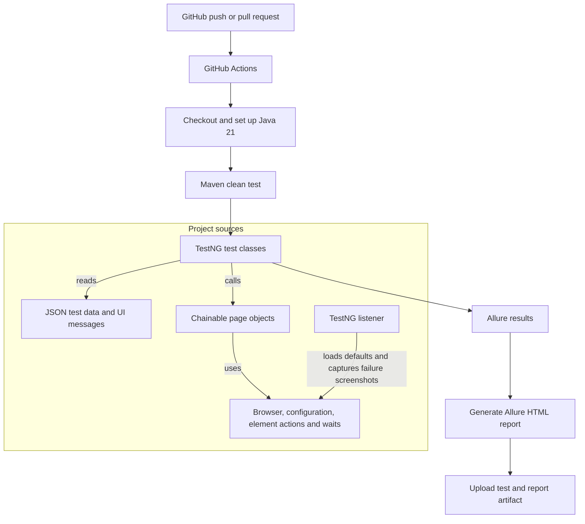

# Selenium UI automation

Maven project for registration and login checks against [AutomationExercise](https://automationexercise.com/). It uses Java 21, Selenium WebDriver, TestNG, JSON test data, page objects, and Allure.

## Project structure

```text
src/
├── main/
│   ├── java/com/automationexercise/
│   │   ├── framework/
│   │   │   ├── browser/DriverFactory.java
│   │   │   ├── config/PropertiesReader.java
│   │   │   └── elements/{ElementActions, WaitUtils}.java
│   │   └── pages/{HomePage, LoginPage, RegisterUserPage}.java
│   └── resources/{environment, execution}.properties
└── test/
    ├── java/com/automationexercise/
    │   ├── data/JsonFileManager.java
    │   ├── support/TestNgListener.java
    │   └── tests/{LoginTests, RegisterTests}.java
    └── resources/{loginTestData, registrationData, uiMessages}.json
```

Test classes contain the test cases and their `@BeforeMethod` / `@AfterMethod` browser lifecycle. Page objects keep browser actions and checks together, and return themselves so test steps can be chained. Framework classes handle only browser setup, element actions, waits, and configuration. Test data and expected messages stay in JSON resources.

## Project flow



## Run locally

Prerequisites: JDK 21, Maven, and Chrome, Firefox, or Edge. Selenium Manager resolves the browser driver.

```powershell
mvn clean test
```

Chrome runs headlessly by default. Override settings with Java system properties, for example:

```powershell
mvn test -Dbrowser=firefox -Dheadless=false -DwaitTimeOutSeconds=45
```

Supported browser values are `chrome`, `firefox`, and `edge`. Defaults are in `src/main/resources/environment.properties` and `src/main/resources/execution.properties`; command-line system properties take precedence.

## Test data

- `loginTestData.json` has the valid and invalid login examples.
- `RegistrationData.json` has new-account and existing-account values.
- `uiMessages.json` has the page headings, confirmations, and validation messages.

`JsonFileManager` reads these files from the test classpath. A successful-registration test adds a unique suffix to the username and email so repeated runs do not collide. The existing-account check needs an email already registered on the target site.

## Reports

Surefire output is written to `target/surefire-reports`; Allure results are written to `target/allure-results`. Generate the HTML report with:

```powershell
mvn allure:report
```

GitHub Actions runs the suite on pushes and pull requests, generates the Allure report when results exist, and uploads the reports as a workflow artifact.
