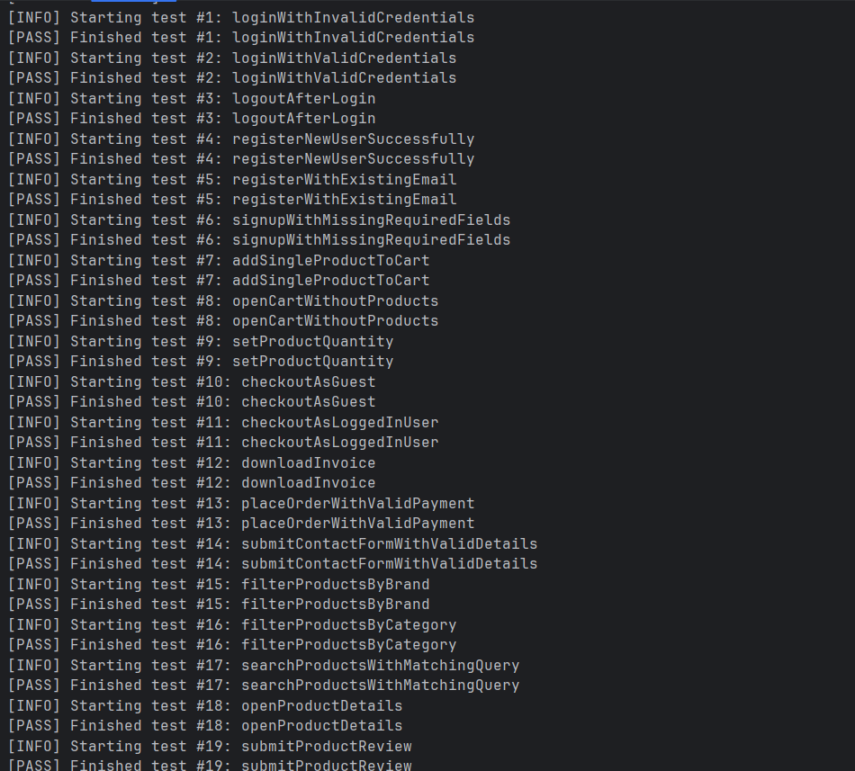
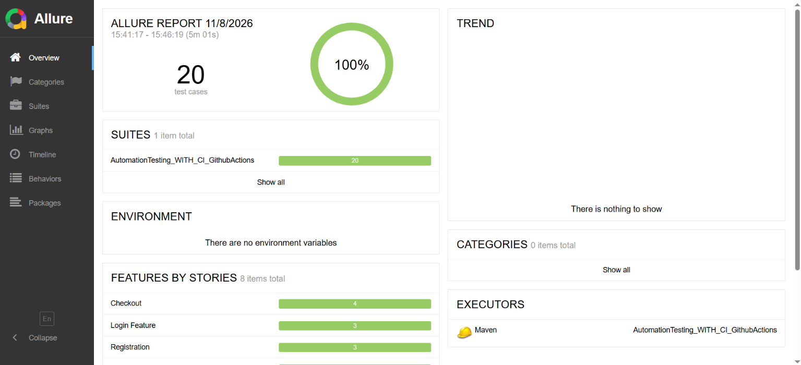
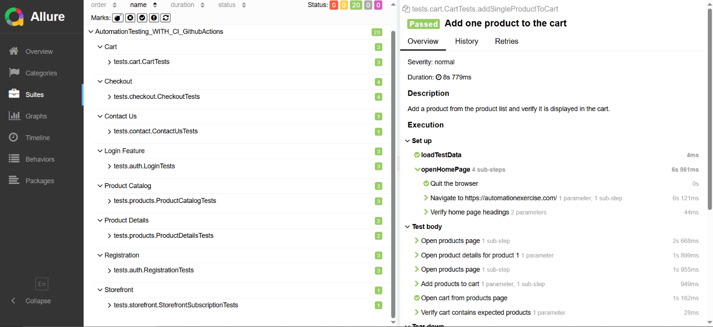
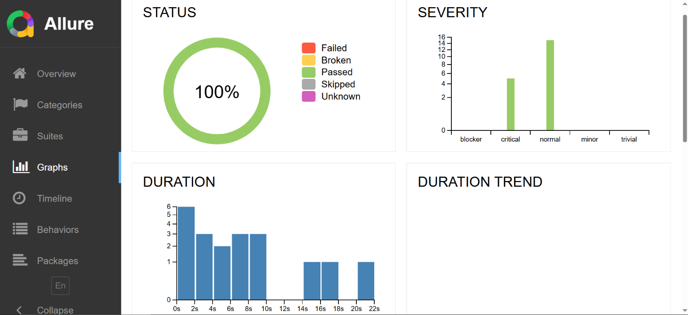
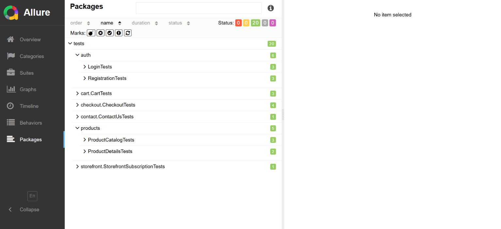
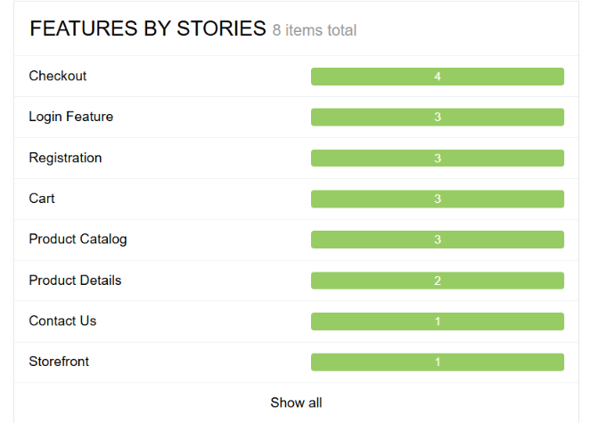

# AutomationExercise UI Automation Framework

Java-based UI automation for [AutomationExercise](https://automationexercise.com/). The project demonstrates a maintainable Selenium framework built around a **fluent Page Object Model (POM) with method chaining**, data-driven TestNG scenarios, reusable browser utilities, Allure reporting, and CI configuration.

The current suite covers authentication, registration, product catalog and details, cart, checkout, contact form, and storefront subscription flows. The suite runs against a public practice website, so results depend on the site's availability and test-account data.

## Contents

- [Technology stack](#technology-stack)
- [Automated coverage](#automated-coverage)
- [Architecture](#architecture)
  - [Fluent Page Objects and method chaining](#fluent-page-objects-and-method-chaining)
  - [Shared framework utilities](#shared-framework-utilities)
- [Project structure](#project-structure)
- [Requirements](#requirements)
- [Run the suite](#run-the-suite)
- [Allure report](#allure-report)
- [CI configuration](#ci-configuration)

## Technology stack

| Technology | Version / use |
| --- | --- |
| Java | 21 |
| Maven | Build and dependency management |
| Selenium WebDriver | 4.52.0; browser automation |
| TestNG | 7.11.0; test execution and lifecycle |
| Allure TestNG | 3.0.0; test results and reporting |
| JsonPath | 2.10.0; JSON test-data queries |
| JSON Simple | 1.1.1; JSON parsing |
| AspectJ Weaver | 1.9.25; Allure instrumentation |

## Automated coverage

| Feature | Scenarios |
| --- | --- |
| Login | Valid credentials, invalid credentials, logout |
| Registration | Successful registration and account cleanup, duplicate email, missing required fields |
| Product catalog | Search results, category filtering, brand filtering |
| Product details | Verify product name and price, submit a product review |
| Cart | Add a product, set quantity and verify total, open an empty cart |
| Checkout | Guest checkout prompt, logged-in delivery and billing addresses, successful payment, invoice download |
| Contact | Submit the contact form with valid details and file upload |
| Storefront | Subscribe with a valid email |

At the time these screenshots were supplied, the Allure run contained **20 test cases with a 100% pass rate**. This is a saved execution result, not a live CI status indicator.

## Architecture

### Fluent Page Objects and method chaining

- `HomePage` and `StorefrontPage` model the home page and shared storefront navigation.
- `SignupLoginPage`, `LoginPage`, and `RegisterUserPage` model the signup, login, and registration steps. `AccountCreatedPage` and `AccountDeletedPage` model their confirmation states.
- `ProductsPage` and `ProductDetailsPage` separate catalog actions from product-detail actions.
- `CartPage`, `CheckoutPage`, and `ContactUsPage` model cart, order, payment, and contact-form workflows.

The Page Object Model uses a fluent design and method chaining: page actions return the current page object, while navigation actions return the destination page object. This keeps test flows readable and makes page transitions explicit.

### Shared framework utilities

- `DriverFactory` creates and manages Chrome, Firefox, or Edge sessions.
- `BrowserUtils`, `ElementActions`, and `WaitUtils` provide navigation, common element interactions, and explicit waits.
- `AlertActions` handles browser alerts; `Validations` contains reusable UI checks.
- `PropertiesReader` loads configuration defaults, and `JsonFileManager` reads JSON values by JsonPath.
- `TestNgListener` loads defaults at suite start, logs test outcomes, attaches failure screenshots to Allure, and generates the Allure report after execution.
- `TestDataFactory` creates unique timestamped values for tests such as registration and product reviews.

## Project structure

```text
.
├── .github/
│   └── workflows/
│       └── CI.yml.txt                    # CI workflow definition (see CI note below)
├── docs/
│   └── images/
│       ├── test-execution-console.png    # Supplied TestNG console screenshot
│       ├── allure-overview.png           # Allure run overview
│       ├── allure-suites.png             # Test suites and execution steps
│       ├── allure-graphs.png             # Status, severity, and duration graphs
│       ├── allure-packages.png           # Test package breakdown
│       └── allure-feature-summary.png    # Feature totals
├── src/
│   ├── main/
│   │   ├── java/
│   │   │   ├── pages/                    # Fluent page classes with method chaining
│   │   │   └── utils/                    # Driver, actions, waits, config, data, listener
│   │   └── resources/
│   │       ├── environment.properties     # Base URL and browser settings
│   │       └── execution.properties      # Wait and execution settings
│   └── test/
│       ├── java/
│       │   ├── support/                  # Test-data helpers
│       │   └── tests/
│       │       ├── auth/
│       │       ├── cart/
│       │       ├── checkout/
│       │       ├── contact/
│       │       ├── products/
│       │       └── storefront/
│       └── resources/testdata/           # Feature-specific data and messages
├── pom.xml
└── README.md
```

Test data is organized under `src/test/resources/testdata/` by feature: `auth/login`, `auth/registration`, `cart`, `checkout`, `contact`, `products`, `review`, and `storefront`. Most feature folders contain separate JSON files for test inputs and expected messages. Contact test data also includes the file-upload fixture.

## Requirements

- JDK 21
- Maven
- Chrome, Firefox, or Microsoft Edge
- Network access to AutomationExercise

Selenium Manager resolves the browser driver when the test session starts; no driver executable is stored in the repository.

## Run the suite

From the repository root, run:

```bash
mvn clean test
```

Default settings are Chrome, headless mode enabled, window maximization disabled, and a 30-second wait timeout. Override the settings with Maven system properties:

```bash
mvn clean test -Dbrowser=firefox -Dheadless=false -DwindowMaximize=true -DwaitTimeOutSeconds=45
```

Supported `browser` values are `chrome`, `firefox`, and `edge`. You can also override the site URL:

```bash
mvn clean test -DbaseUrl=https://automationexercise.com/
```

Defaults come from `src/main/resources/environment.properties` and `src/main/resources/execution.properties`. Java system properties passed with `-D` take precedence over those defaults.

### Sample execution output

This console capture was supplied with the project and shows the visible passing TestNG results from the same execution represented in the Allure report below.



## Allure report

TestNG and Surefire output is written to `target/surefire-reports/`. Allure results are written to `target/allure-results/`, and the generated HTML report is written to `target/allure-report/`.

The TestNG listener generates an Allure report after suite execution. To regenerate it manually from existing results, run:

```bash
mvn allure:report
```

The local report entry point is `target/allure-report/index.html`. The `target/` directory is build output; the workflow definition includes a step to upload report outputs as an artifact.

### Allure report screenshots

The overview shows 20 test cases and a 100% pass rate. The other views show the suite/test steps, status and severity graphs, package breakdown, and feature totals.



<details>
<summary>More Allure report views</summary>

#### Suites and test steps



#### Status, severity, and duration graphs



#### Package breakdown



#### Feature summary



</details>

## CI configuration

The repository includes a GitHub Actions workflow definition in `.github/workflows/CI.yml.txt`. Its configuration is set up for pushes, pull requests, and manual dispatch; Java 21 on Ubuntu; `mvn clean test`; Allure report generation; and upload of test and report artifacts for 14 days.

**Activation note:** GitHub Actions discovers workflow files ending in `.yml` or `.yaml` under `.github/workflows/`. The current file has an additional `.txt` extension, so GitHub will not run it automatically until it is renamed to a supported extension. See the [GitHub Actions workflow syntax documentation](https://docs.github.com/en/actions/reference/workflows-and-actions/workflow-syntax).
